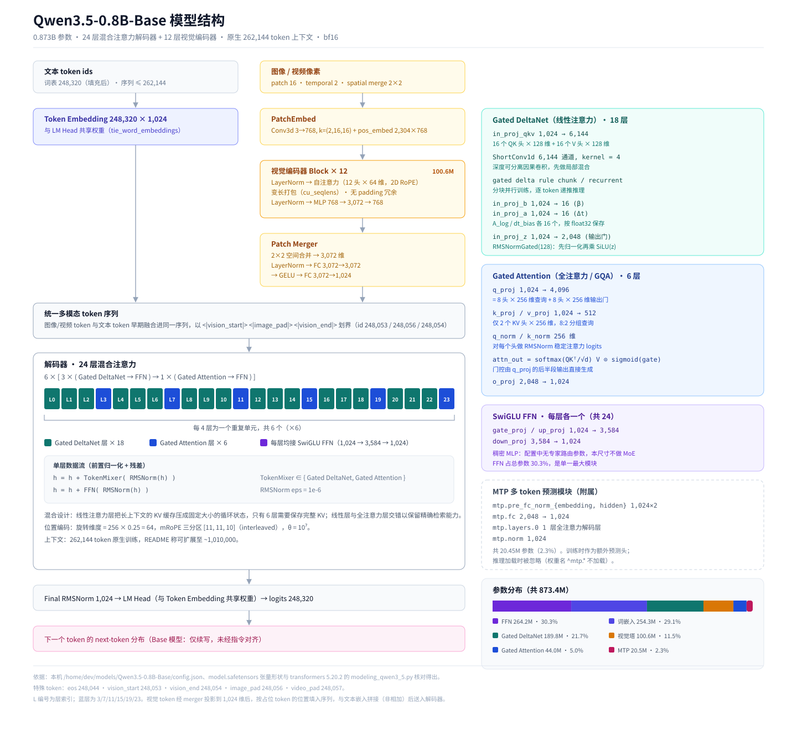

# Qwen3.5-0.8B-Base 模型介绍

> 本文所列结构参数均取自本机实际权重（`/home/dev/models/Qwen3.5-0.8B-Base`）的 `config.json`、`model.safetensors` 张量形状，并对照 transformers 5.20.2 中 `modeling_qwen3_5.py` 的实现核对。

## 1. 一句话概括

Qwen3.5-0.8B-Base 是 Qwen3.5 系列的最小尺寸**预训练**模型：一个 0.873B 参数的**原生多模态**解码器，用 24 层「线性注意力为主 + 周期性全注意力」的混合架构，配一个 12 层的轻量视觉编码器，原生上下文 262,144 tokens。它不是用来直接对话的，而是作为微调与研究的起点。



## 2. 关键规格

| 项目 | 数值 |
| --- | --- |
| 总参数量 | 873.4M（bf16，约 1.75 GB 单文件） |
| 架构类 | `Qwen3_5ForConditionalGeneration` |
| 层数 | 24（18 层 Gated DeltaNet + 6 层 Gated Attention） |
| 隐藏维度 | 1,024 |
| 词表 | 248,320（填充后），输入嵌入与 LM Head 共享 |
| FFN 中间维 | 3,584（SwiGLU，稠密） |
| 全注意力 | 8 个 Q 头 / 2 个 KV 头，head_dim 256（GQA 8:2） |
| 线性注意力 | 16 个 QK 头 + 16 个 V 头，head_dim 128，卷积核 4 |
| 旋转位置编码 | 旋转 64 维（256 × 0.25），mRoPE 三分区 [11,11,10]，θ = 1e7 |
| 上下文长度 | 262,144 原生，README 称可扩展至约 1,010,000 |
| 视觉编码器 | 12 层，hidden 768，12 头 × 64 维，patch 16 / temporal 2 / 空间合并 2×2 |
| 训练阶段 | 仅预训练（Pre-training only） |
| 许可证 | Apache-2.0 |

## 3. 整体构造

```
文本 token ──> Token Embedding ─┐
                                ├─> 统一多模态 token 序列 ──> 24 层混合解码器 ──> RMSNorm ──> LM Head
图像/视频 ──> PatchEmbed ──> 视觉 Block×12 ──> Patch Merger ─┘                              │
                                                                                    logits 248,320
                                          （旁路：MTP 模块，仅训练期使用）
```

两条支路在**输入层**就汇合：视觉 token 先被视觉塔编码，再经 merger 投影到 1,024 维，按占位 token 的位置填进序列，与文本嵌入处在同一个 token 空间里。这属于早期融合（early fusion），而不是「编码器 + 交叉注意力」的后期融合——解码器从第一层起看到的就是混合序列。

### 3.1 视觉塔

- **PatchEmbed**：Conv3d，输入 3 通道，输出 768 维，核大小 `(2, 16, 16)`——即时间上 2 帧、空间上 16×16 像素算一个 patch。位置编码是可学习的 `pos_embed`，2,304 × 768。
- **12 个 Block**：LayerNorm → 自注意力（12 头 × 64 维，带 2D RoPE）→ LayerNorm → MLP（768 → 3,072 → 768）。前处理会把多张图/多个视频打包成一条变长序列，配合 `cu_seqlens` 做无 padding 的注意力计算。
- **Patch Merger**：2×2 空间合并，把 4 个 patch 的特征拼成 3,072 维，LayerNorm 后接 FC 3,072 → 3,072、GELU、FC 3,072 → 1,024。这一步同时完成降采样和投影到语言模型维度，参数量主要集中在这两个 FC 上。
- 整个视觉塔约 **100.6M** 参数（占总量的 11.5%）。

### 3.2 文本解码器：混合注意力

24 层按 `3 线性 + 1 全注意力` 为一组，重复 6 组（对应配置里的 `full_attention_interval = 4`）。全注意力落在索引 3、7、11、15、19、23 层。

每一层都是前置归一化 + 残差：

```
h = h + TokenMixer( RMSNorm(h) )      # TokenMixer 是 GDN 或 Gated Attention
h = h + FFN( RMSNorm(h) )             # FFN 两种层都有，参数形状相同
```

**Gated DeltaNet（18 层）——线性注意力**

- `in_proj_qkv`：1,024 → 6,144，其中 Q、K 各 16 头 × 128 维，V 为 16 头 × 128 维。
- 紧跟一个深度可分离 **ShortConv1d**（6,144 通道，kernel = 4，因果、分组卷积），负责极短距离的局部混合。
- 核心是 **gated delta rule**：训练时走分块并行（chunk）路径，推理时走逐 token 递推（recurrent）路径，两条路径在数学上等价。递推形式让它的状态大小**不随上下文长度增长**。
- `in_proj_b`（1,024 → 16）给出写入门控 β；`in_proj_a`（1,024 → 16）给出步长 Δt，配合 `dt_bias`（16）和 `A_log`（16）计算衰减——这三个小张量虽然只占 16 个数，却是整个线性注意力「遗忘多少历史」的控制旋钮。
- `in_proj_z`（1,024 → 2,048）产生输出门，经 `RMSNormGated(128)` 时**先归一化、再乘 SiLU(z)**，然后 `out_proj`（2,048 → 1,024）回到隐藏维。

**Gated Attention（6 层）——全注意力 / GQA**

- `q_proj`：1,024 → 4,096。注意它是普通 8 头 × 256 维的两倍，因为输出被切成两半：一半是查询，另一半就是这个注意力层的**输出门**。`attn_output = attn_output * sigmoid(gate)`。
- `k_proj` / `v_proj`：1,024 → 512，即 2 个 KV 头 × 256 维，与 8 个查询头构成 8:2 的 GQA。
- `q_norm` / `k_norm`（各 256 维）对每个头做 RMSNorm，抑制注意力 logits 的数值漂移。
- 位置信息只作用于 head_dim 的前 64 维（旋转因子 0.25），并按 [11, 11, 10] 切成时间、高、宽三段交错施加——这正是它能处理图像/视频 token 的关键。
- `o_proj`：2,048 → 1,024。

**这样设计的取舍**：18 层线性注意力让长上下文的 KV 缓存基本恒定，只有 6 层需要存完整 KV；保留的 6 层全注意力负责精确检索和长程依赖，避免纯线性注意力在「大海捞针」类任务上的退化。

### 3.3 FFN 与 MTP

- 每层（两种层都有）一个 SwiGLU FFN：`gate_proj` / `up_proj` 1,024 → 3,584，`down_proj` 3,584 → 1,024。**全部稠密**——配置中没有专家路由参数，Qwen3.5 家族里 MoE 属于更大尺寸的型号。
- **MTP（Multi-Token Prediction）**：`mtp.fc` 2,048 → 1,024，加 1 层全注意力解码层和 `mtp.norm`，共 20.45M 参数。训练时作为额外的下一 token 预测头；推理加载时被忽略（权重名 `^mtp.*` 不加载），这也是加载后实际参数为 853M 而非 873M 的原因。

## 4. 参数量分布

| 模块 | 参数量 | 占比 |
| --- | --- | --- |
| SwiGLU FFN（24 层） | 264.2M | 30.3% |
| Token Embedding（共享） | 254.3M | 29.1% |
| Gated DeltaNet（18 层） | 189.8M | 21.7% |
| 视觉塔（12 层 + merger） | 100.6M | 11.5% |
| Gated Attention（6 层） | 44.0M | 5.0% |
| MTP | 20.5M | 2.3% |
| RMSNorm 等 | 0.05M | ~0% |
| **合计** | **873.4M** | 100% |

几个值得注意的点：

- **词表占了近三成**。248,320 的词表乘以 1,024 维就是 254M，而因为权重共享，LM Head 不再额外占一份。Qwen3.5 系列扩大词表（覆盖 201 种语言）对小模型来说比例代价很高。
- **FFN 是最大的单一模块**。单层 FFN 11.0M，是单层 GDN（10.5M）或单层注意力（7.3M）的 1.5~1.1 倍，24 层累加起来就超过三分之一。
- **线性注意力比全注意力重得多**：18 层 GDN 的 189.8M，是 6 层全注意力 44.0M 的 4.3 倍。GDN 的单层参数几乎全在三个大投影上；全注意力则因为 KV 头只有 2 个，`k_proj` / `v_proj` 极省。
- **只算文本主干是 0.752B**，加上视觉塔才 0.853B。0.8B 的命名大致对应「文本主干 + 视觉塔」。

## 5. 特殊 token 与分词

| token | id |
| --- | --- |
| `<|endoftext|>`（eos / pad） | 248,044 |
| `<|vision_start|>` | 248,053 |
| `<|vision_end|>` | 248,054 |
| `<|image_pad|>` | 248,056 |
| `<|video_pad|>` | 248,057 |

分词器基于 BPE（`vocab.json` + `merges.txt`），`add_bos_token = False`，`model_max_length = 262144`。

一个容易忽略的点：虽然这是 Base 模型，但 `tokenizer_config.json` 里**内置了官方的 chat template**（含 `<|im_start|>` / `<|im_end|>`、工具调用格式和 `enable_thinking` 开关）。官方 README 明说这些控制 token 在预训练阶段已被训练过，目的就是让研究者在做 LoRA 之类 PEFT 时不必再额外微调 embedding——对 24.8 万词表来说这是很实在的节省。但请注意：模板存在 ≠ 模型会按模板听话，Base 权重没有经过指令对齐。

## 6. 本机文件与加载

模型目录：`/home/dev/models/Qwen3.5-0.8B-Base`

```
config.json                          2.9 KB
model.safetensors-...-of-00001.safetensors   1.75 GB  (bf16, 488 个张量)
model.safetensors.index.json
tokenizer.json / tokenizer_config.json / vocab.json / merges.txt
preprocessor_config.json / video_preprocessor_config.json
README.md / LICENSE (Apache-2.0)
```

该文件 sha256 为 `c2b1e5a17d9c1e27685d92ed9b382911ebb99955ecd89052d1721241adfbab6c`，与 hf 缓存记录的期望哈希一致，下载完整。

加载（已在本机做前向验证，输入 "The capital of France is" 输出 " Paris"）：

```python
import torch
from transformers import AutoTokenizer, AutoModelForImageTextToText

path = "/home/dev/models/Qwen3.5-0.8B-Base"
tok = AutoTokenizer.from_pretrained(path)
model = AutoModelForImageTextToText.from_pretrained(
    path, dtype=torch.bfloat16, device_map="cuda:0"
)   # Qwen3_5ForConditionalGeneration, 0.853B, 显存约 1.7 GB

ids = tok("The capital of France is", return_tensors="pt").to("cuda:0")
with torch.no_grad():
    out = model(**ids, use_cache=False)
print(tok.decode(out.logits[0, -1].argmax(-1)))   # " Paris"
```

只做纯文本微调时，也可以走 `AutoModelForCausalLM`（对应 `Qwen3_5ForCausalLM`，0.752B），视觉塔不会被加载。

> 环境提示：本机 `AutoProcessor` 的加载会失败，因为视频/图像前处理链依赖 **torchvision**，而当前 venv 未安装。纯文本用法不受影响；要处理图像或视频，先 `pip install torchvision`。

## 7. 与 Chat 版的区别

| | 0.8B-Base | 0.8B（Chat） |
| --- | --- | --- |
| 权重 | 未做指令对齐 | SFT / RL 后训练 |
| 用途 | 微调起点、研究 | 直接对话、工具调用 |
| 结构参数 | 完全一致（config.json 逐字节相同） | 同左 |
| 输出风格 | 续写 | 遵循指令，可开/关 thinking |

两者**结构完全相同**，只有权重不同——从 Chat 版的模型卡元数据 `base_model: Qwen/Qwen3.5-0.8B-Base` 也能看出来。所以拿 Base 做 LoRA 时，架构层面的坑在 Chat 版上都能先验证一遍。

## 8. 使用注意

- 它是**预训练模型**：直接 `generate` 只会续写，不会回答问题，别拿它当聊天机器人。
- 原生上下文 262,144，但 0.8B 容量有限，超长输入下的实际有效召回会明显衰减；README 提到的百万级扩展需要配合 YaRN 之类的长度外推参数。
- 视觉输入需要先装 torchvision 并走 `Qwen3VLProcessor` 前处理，分辨率约束由 `preprocessor_config.json` 中的 `shortest_edge = 65536`、`longest_edge = 16777216`（按像素面积计）控制。
- MTP 权重默认不加载；若要做投机解码研究，需要显式读取 `mtp.*` 张量。
- Apache-2.0，可商用。
