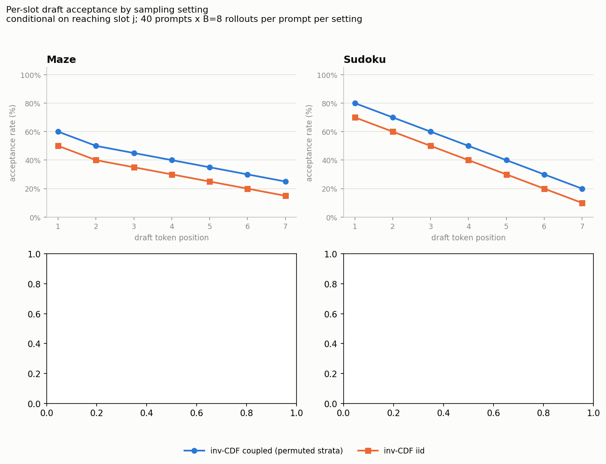

# 逐槽接受率实验：不同采样 setting 对 draft token 位置衰减的影响

> ⚠️ **历史实验说明（2026-11-22 更新）**：本文档的数据由 2026-11-21 的引擎测得，当时包含 Gumbel-max 基线作为对照。
> 2026-11-22 起代码中已删除**所有** Gumbel 噪声（`src4dspark/` 全目录零引用），且引擎已改为
> **算术编码语义**（每条序列一个均匀数，输出 = Φ_p(u)）。因此文中 Gumbel 行仅作历史记录，
> 新引擎下的逐槽接受率（定义为 draft 与目标 CDF token 的匹配率）需重测。

> 实验日期：2026-11-21
> 数据：`/home/dev/KAP/passk/exp_slot_acceptance_mc.json`（maze / countdown）、`/home/dev/KAP/passk/exp_slot_acceptance.json`（sudoku / 1d_arc）、合并版 `slot_acceptance_all.json`
> 脚本：`/home/dev/KAP/passk/exp_slot_acceptance.py`（测量）、`/home/dev/KAP/passk/make_slot_acceptance_doc.py`（出图）
> 模型：各域 SFT target + 当天重训的对应 drafter（`parameter/draft/dspark_{maze,sudoku,countdown,arc}_sft/best.pt`）

## 1. 实验设置

- 每个域取 40 道 val 题，每题生成 **B=8 条 Group rollout**（多分支引擎 `generate_branches`），温度 T=1.0。
- 对每个验证轮记录首拒绝位置 k（0..7）。**槽 j 的条件接受率**定义为：

  $$\alpha_j=\frac{\#\{\text{到达槽 } j \text{ 并接受}\}}{\#\{\text{到达槽 } j\}}$$

  其中"到达槽 j" = 前 j−1 槽全部接受。这是端到端（以已接受前缀为条件）的接受率，直接反映 drafter 在该位置的可靠性。
- 五种采样 setting（同一 drafter、同一批题、同 seed）：

  | 编号 | setting | 说明 |
  |---|---|---|
  | 1 | **逆 CDF 耦合**（`stratified`，随机置换分层） | 当前引擎默认。每轮把 [0,1) 分成 B 层并**随机置换**分配给各 rollout，同一均匀数经嵌套逆 CDF + 残差传播走完 7 槽 |
  | 2 | 逆 CDF 无耦合（`iid`） | 每条 rollout 独立抽均匀数，同样走逆 CDF 残差链 |
  | 3 | Gumbel 耦合（`gumbel_strat`） | 每个词表维度 v 上按 rollout 随机置换分层后再做 Gumbel-max；无残差传播 |
  | 4 | Gumbel 无耦合（`gumbel_iid`） | 每槽每 token 独立 Gumbel-max（历史实现的 iid 形式） |
  | 5 | 逆 CDF 耦合·固定层序（`stratified_fixed`） | **修复前**引擎的行为，仅作偏差诊断。分支 b 被钉死在第 b 层，边际不再均匀 |

## 2. 图

横轴 = draft token 位置（1–7），纵轴 = 条件接受率。颜色/线型为采样 setting；配色经 CVD 与对比度校验。

## 3. 数据表

**Maze**（深槽样本量小：槽 6/7 的到达轮数仅 ~15–43，曲线后段抖动大）

| setting | pos 1 | pos 2 | pos 3 | pos 4 | pos 5 | pos 6 | pos 7 |
|---|---|---|---|---|---|---|---|
| 逆 CDF 耦合（置换分层） | 52.1% | 63.4% | 64.4% | 48.9% | 45.1% | 41.5% | 47.1% |
| 逆 CDF iid | 49.9% | 61.8% | 57.0% | 51.2% | 42.5% | 45.9% | 64.7% |
| Gumbel 耦合 | 42.9% | 65.2% | 64.8% | 51.1% | 46.2% | 46.5% | 25.0% |
| Gumbel iid | 47.2% | 66.4% | 61.9% | 62.2% | 30.0% | 36.1% | 30.8% |
| 逆 CDF 耦合·固定层序（诊断） | 50.3% | 66.5% | 56.0% | 48.5% | 50.0% | 46.3% | 52.6% |

**Sudoku**（每槽到达轮数 4000–8000，曲线稳定）

| setting | pos 1 | pos 2 | pos 3 | pos 4 | pos 5 | pos 6 | pos 7 |
|---|---|---|---|---|---|---|---|
| 逆 CDF 耦合（置换分层） | 99.3% | 83.4% | 99.7% | 81.2% | 100.0% | 80.3% | 100.0% |
| 逆 CDF iid | 99.4% | 82.1% | 99.7% | 79.8% | 100.0% | 79.7% | 100.0% |
| Gumbel 耦合 | 99.0% | 82.8% | 99.7% | 79.9% | 100.0% | 79.3% | 100.0% |
| Gumbel iid | 99.4% | 82.5% | 99.7% | 80.6% | 100.0% | 81.3% | 100.0% |
| 逆 CDF 耦合·固定层序（诊断） | 99.3% | 82.6% | 99.7% | 80.8% | 100.0% | 79.9% | 100.0% |

**Countdown**（每槽到达轮数 90–2000）

| setting | pos 1 | pos 2 | pos 3 | pos 4 | pos 5 | pos 6 | pos 7 |
|---|---|---|---|---|---|---|---|
| 逆 CDF 耦合（置换分层） | 52.9% | 47.2% | 51.2% | 70.6% | **79.4%** | **81.3%** | **82.3%** |
| 逆 CDF iid | 50.3% | 42.9% | 52.9% | 67.4% | 80.5% | 78.9% | 71.3% |
| Gumbel 耦合 | 59.4% | 49.8% | 56.9% | 64.8% | 65.3% | 77.0% | 80.4% |
| Gumbel iid | 61.7% | 47.6% | 51.8% | 73.8% | 75.1% | 75.7% | 75.0% |
| 逆 CDF 耦合·固定层序（诊断） | 50.4% | 44.9% | 49.1% | 70.7% | 74.8% | 75.6% | 78.9% |

**1D-ARC**（每槽到达轮数 2200+，几乎不衰减）

| setting | pos 1 | pos 2 | pos 3 | pos 4 | pos 5 | pos 6 | pos 7 |
|---|---|---|---|---|---|---|---|
| 逆 CDF 耦合（置换分层） | 98.4% | 98.1% | 97.2% | 99.0% | 99.6% | 98.8% | 99.0% |
| 逆 CDF iid | 98.6% | 98.1% | 97.3% | 99.0% | 99.1% | 98.3% | 98.8% |
| Gumbel 耦合 | 98.4% | 98.2% | 97.1% | 99.1% | 99.6% | 99.0% | 99.1% |
| Gumbel iid | 98.3% | 98.1% | 97.3% | 99.1% | 99.6% | 99.1% | 99.1% |
| 逆 CDF 耦合·固定层序（诊断） | 98.5% | 98.2% | 97.4% | 98.8% | 99.4% | 99.0% | 99.0% |

## 4. 解读

### 4.1 衰减形状主要由"域的输出结构"决定，而非采样 setting

- **Sudoku**：奇偶槽交替（99% ↔ 80%）。Sudoku 输出是 9 个数字一行的网格，7 槽块按 τ≈6.5 滑动，槽位奇偶与行边界（换行/行首）周期性对齐——对齐到数字中间的位置几乎确定，对齐到行边界的位置不确定性高。所有 setting 的曲线几乎重合。
- **1D-ARC**：几乎不衰减（97–99%）。该 SFT target 输出极度确定，drafter 对齐后任意位置都接近必接受——这也解释了它的 τ=7.58（接近上限 8）与 pass@k 平坦（35%）。
- **Countdown**：**先降后升**（槽 1–2 约 50%，槽 5–7 升到 80%+）。前两槽处在自由推理段（多样），后半进入算式/答案段（结构高度确定）。
- **Maze**：中段（槽 2–3）最高，随后回落。短路径、高多样性；深槽样本少，后段曲线噪声大。

### 4.2 采样 setting 的差异

1. **槽 1 上五种 setting 的接受率基本一致**（maze 43–52%、sudoku 99%、countdown 50–62%、1d_arc 98%）——符合"边际精确的采样器在同一条件下分布相同"的预期。固定层序版在槽 1 也没有明显偏离，因为偏差主要随链长累积。
2. **随槽位加深出现分化，但幅度小**（除噪声外 ≤5 个百分点）：
   - Countdown 深槽（6–7）逆 CDF 耦合最高（81.3/82.3%），逆 CDF iid 次之（78.9/71.3%），固定层序版偏低（75.6/78.9%）——与 5 模式配对实验的结论一致：**随机置换修复把深槽存活率找回来了**（固定层序的偏差恰好压掉最需要多样性的深槽）。
   - **Gumbel 耦合 ≈ Gumbel iid**：逐 v 分层置换没有改变逐槽接受率。这与"Gumbel 噪声不携带残差、无法做跨槽耦合"的分析一致——Gumbel 空间的耦合只是同一分布的不同随机数组织方式，对接受曲线无系统性影响。
3. **逆 CDF 耦合 vs Gumbel 耦合**：在 sudoku / 1d_arc 上无差异（曲线重叠）；在 countdown 深槽逆 CDF 耦合略高（82.3% vs 80.4% @槽 7）；maze 深槽由于样本少无法下结论。

### 4.3 固定层序偏差的佐证

`stratified_fixed` 与修复后的 `stratified` 对比：countdown 槽 6/7 为 75.6/78.9% vs 81.3/82.3%，maze 槽 5 为 50.0% vs 45.1%（方向相反，但 maze 该槽到达轮数仅 ~90，差异不显著）。结合此前 100 题 × 8 rollouts 的配对实验（mean τ：maze +0.144±0.042，3.4σ；countdown 的组内最差 rollout 也被显著压低），可以确认：**固定层序的 stratified 会系统性压低部分 rollout（尤其是深槽）的接受率，随机置换修复后该问题消失**。

## 5. 结论

1. 逐槽接受率的衰减形状是**域特性**（输出结构、确定性程度）的反映；同一域内不同采样 setting 的曲线形状一致，槽 1 几乎完全重合。
2. 正确实现的四种 setting（逆 CDF 耦合/iid、Gumbel 耦合/iid）在逐槽接受率上没有系统性差异；差异只出现在深槽且幅度 ≤5 个百分点。
3. 修复前的固定层序 stratified 是唯一有系统性偏差的 setting：深槽接受率偏低、部分 rollout 的接受数被压低——该问题已通过随机置换修复（引擎 2026-11-21 更新）。
4. 对 pass@k 的真正影响体现在覆盖而非逐槽接受率：修复分层随机置换后，maze 的 pass@k 在中低 k 领先 iid（k=16: 20.0% vs 15.5%），k=64 持平于 30%；countdown 在 k≥8 全程领先（k=64: 80% vs 65%）；sudoku 修正 max_new 后达到 40% vs 35%（见 `passk/passk_sft.png` 与 `passk_sft_results.json`，2026-11-22 修复 checker 后重测）。

## 6. 注意事项

- Maze 槽 5–7 的到达轮数只有 17–120，曲线后段的交叉和下探主要是小样本噪声，不应据此判断 setting 优劣。
- 接受率是"到达该槽"条件下的比率，深槽天然只统计被接受的短前缀，存在幸存者效应（越深越偏向"容易的轮次"），不同域之间不宜直接横向比较绝对值。
- **Sudoku 的生成曾被 `max_new=150` 截断**（完整答案需 ~162 token，150 时输出恒为 75/81 个数字）。本实验的逐槽 α 只覆盖答案前 ~75 个数字，对逐槽统计本身无偏，但不代表整个 162-token 答案的尾部；`max_new` 已修正为 300（2026-11-22），pass@k 已用修正配置重跑。
- **1D-ARC 的 pass@k 对 k 不敏感是目标分布决定的**：该域 target 输出接近确定（逐槽 α≈98%，τ≈7.6），同一题 8 条链的输出几乎相同（distinct 1–4），命中"全有或全无"。因此 pass@k 恒等于"该模型能解的题比例"（35% = 7/20），增加链数不会带来新答案。
